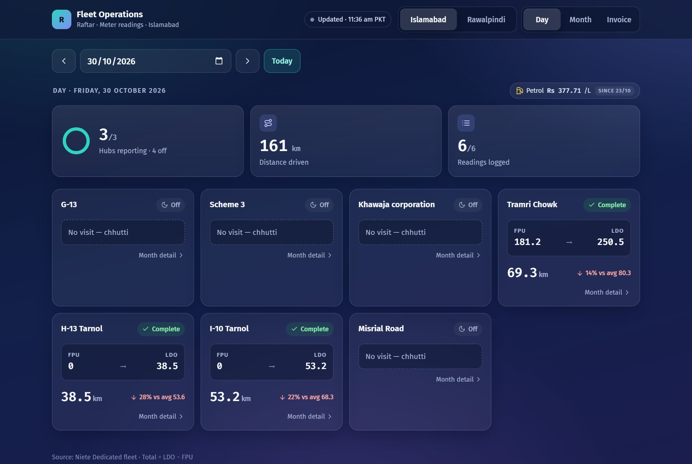
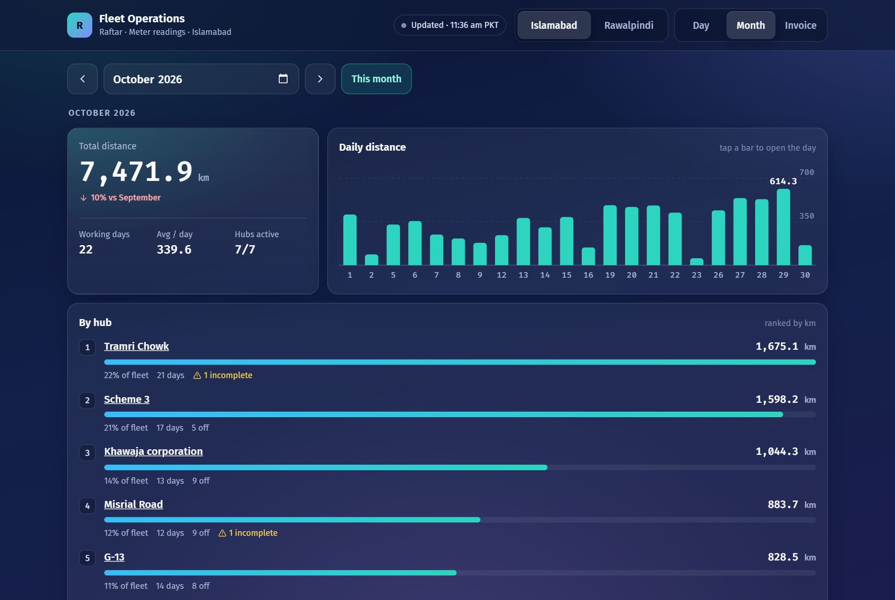
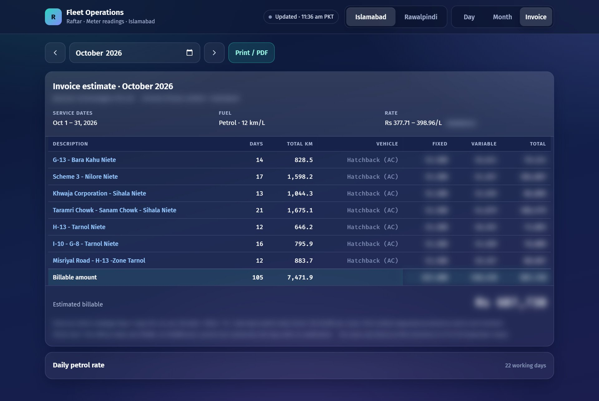
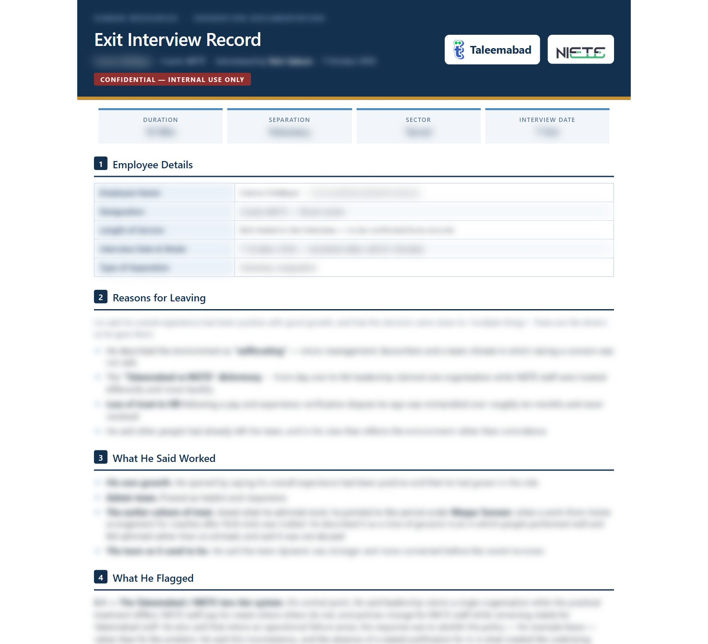

# I'm Not a Developer. I Built AI Agents That Now Run Our Logistics and Exit Interviews.

Every morning used to start the same way. Tea in one hand, phone in the other, zooming into a blurry photo of a meter and trying to decide whether the last digit was a 3 or an 8.

I look after operations and people work at an education organisation in Pakistan. Two parts of my job took far more time than they deserved: logging the kilometres our field transport drives each day, and running exit interviews when colleagues move on.

Over the past few months, I built AI agents to take over the repetitive parts of both. I'm not a software engineer. I'm an operations person who got tired of doing the same thing by hand every day. Here is what changed, mistakes included.

---

## Logistics, before

Each working day, drivers post a photo of the meter in their WhatsApp group: once at morning pick-up, once at evening drop-off.

My job was to turn those photos into numbers. I would open each group in turn, scroll past the greetings and voice notes, zoom in on a small orange display that was often half lost in glare, and type the reading into a Google Sheet under the right route and column. In the evening, I did it all again.

Month end was harder. Our transport is billed as a fixed fee plus fuel for every kilometre, at that day's petrol price. Prices in Pakistan now change almost daily, so checking the invoice meant pairing each day's distance with each day's rate, by hand.

One wrong digit in the morning could quietly throw off the whole month. Usually nobody noticed until much later, if anyone noticed at all.

## Logistics, now

An agent now sits in those WhatsApp groups and nowhere else. When a meter photo arrives, it finds the orange display, reads the kilometres, works out whether it is the morning or evening reading, and writes it into the sheet under the right route. The whole thing takes a few seconds.

What I value most is how it behaves when it is unsure. If a photo is blurry or washed out by glare, it doesn't guess. It sets the photo aside, and I fill that one in myself. We tested it on 160 real photos. It read about seven in ten on its own and got none of them wrong.

> A wrong number in a spreadsheet looks exactly like a right one. An honest "I can't read this" is far easier to deal with.

It didn't get there on the first try. An early version kept reading the speedometer instead of the odometer. Another filed every photo as a morning reading because the server was running on UTC rather than Pakistan time. Each mistake showed me where the next safeguard belonged.

*Each day's readings arrive on their own, morning and evening.*

On top of the data sits a dashboard. I can open any day, see the whole month at a glance, and switch to an invoice view that pulls the official petrol price for each day and works out what the bill should be. When the vendor's invoice arrives, I compare two figures instead of building one from scratch. The first time I did this, it surfaced differences in days and kilometres that I would never have caught by eye.

*The month at a glance: distance by day and by route.*

*The month-end invoice estimate, built from daily distance and the daily fuel price. Amounts blurred.*

---

## Exit interviews, before

When someone resigns, our People & Culture manager replies on the resignation email and asks me to arrange an exit interview. Everything after that used to be manual.

I read the thread to find the person's name, role and last working day. I emailed them to agree on a time and sent the invite. I held the conversation and took notes. Then I turned those notes into a three-to-four-page confidential record, exported it, filed it in Drive and replied to HR.

The conversation is the part that matters. Everything around it is admin, and admin is the first thing to slip in a busy week.

## Exit interviews, now

An agent now watches for that request. Resignations usually arrive as forwards, with the real details buried in the quoted text, so it reads the entire thread to work out who is leaving. I choose a time slot and the invite goes out.

After the meeting, it takes the notetaker's summary and drafts the record in our house style, keeping only what the person actually said. I review it on my phone and approve it. The agent then files the PDF and replies to HR on the original thread.

*A finished record, reviewed by a person before it is filed. Details blurred.*

I still hold every conversation, and I still read every record before it goes anywhere. What has gone is the chasing, the formatting, and the "I'll file it tomorrow."

---

## What I learned

**Start with the boring work.** The best opportunities weren't clever problems. They were tasks I repeated every day without a second thought.

**Teach the tool to say "I'm not sure."** Being right matters more than covering everything. A tool that sets aside three photos in ten and is right about the rest is worth more than one that answers everything and is sometimes wrong without telling you.

**Keep people where judgement matters.** The agent drafts and I approve. The agent reads and I fill the gaps.

**You don't need to be an engineer to start.** I described the problem clearly, tested on real data and fixed what broke, one step at a time.

The hours I have gained now go to the parts of the job that need a person: the conversations, the follow-ups and the decisions.

---

## What I bring to a team

Looking back, this work rests on a handful of skills I now use every week:

- **Workflow design:** breaking a messy daily routine into steps a machine can follow, and knowing which steps still need a person.

- **AI agents:** building and testing agents with Claude Code that read messages, photos and email threads, then act on them.

- **Image reading (OCR):** pulling numbers reliably out of real-world photos, with rules that refuse rather than guess.

- **Integrations:** connecting WhatsApp, Gmail, Google Sheets, Calendar and Drive so nobody has to copy and paste.

- **Dashboards and reporting:** live views and month-end calculations that management can rely on.

- **Cloud deployment:** keeping these tools running around the clock, with secure logins and access control.

- **HR operations:** exit interviews, reference checks and offer letters, done faster without losing the human touch.

I'm open to conversations with organisations that want to bring practical AI into their operations or HR work, whether that is a full-time role, a project, or simply an exchange of ideas. If that sounds like your team, send me a message. I'd be glad to talk.

#Operations #AIAutomation #HROperations #Logistics #ClaudeCode #WorkflowAutomation #OpenToWork
